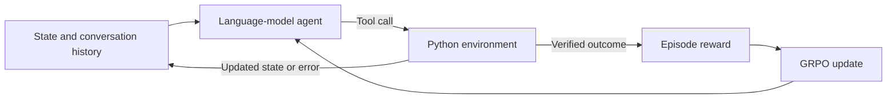
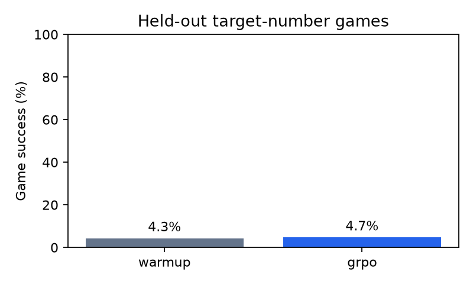
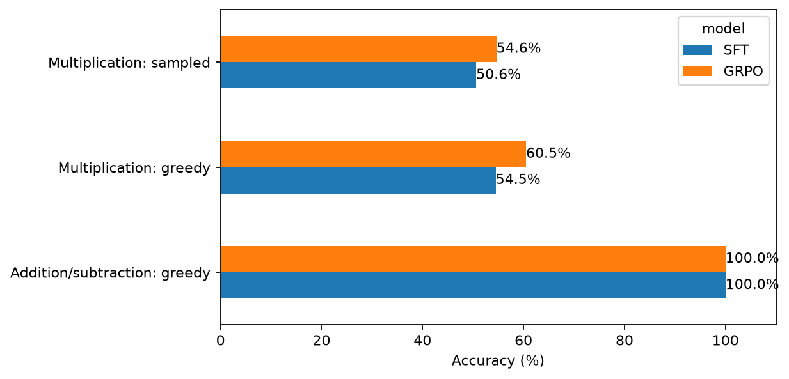

# Arithmetic Post-Training

A small language-model post-training project built around arithmetic: supervised learning, correctness rewards, and interaction with a stateful environment.

The main experiment is a **target-number game**. A language-model agent chooses arithmetic moves, receives observations from a Python environment, and learns from verified outcomes using Group Relative Policy Optimization (GRPO).

The project starts from [Qwen2.5-0.5B Base](https://huggingface.co/Qwen/Qwen2.5-0.5B) and uses PyTorch, Hugging Face Transformers, TRL, and PEFT.

**Start with [Notebook 03: the arithmetic agent](notebooks/03_target_game.ipynb).** Notebooks 01 and 02 build the checkpoints used by this experiment.

### The RL environment

The agent receives three numbers and a target. Each move combines two available numbers using addition, subtraction, or multiplication.

| Component | Definition |
|-----------|------------|
| State | Available numbers, target, remaining attempts, and episode status |
| Action | `combine(i, j, op)`, using two different indices in the current list |
| Transition | Remove the selected numbers and append their arithmetic result |
| Invalid move | Return an error, preserve the numbers, and consume an attempt |
| Termination | One number remains, or the three-attempt budget is exhausted |
| Reward | 1 if the final remaining number equals the target; otherwise 0 |

Each successful solution uses every starting number exactly once. Operators may repeat, and intermediate results may be negative.

For example, this scripted solution reaches target 20:

| Available numbers | Action | Updated numbers |
|-------------------|--------|-----------------|
| `[2, 3, 4]` | `combine(0, 1, "+")` | `[4, 5]` |
| `[4, 5]` | `combine(0, 1, "*")` | `[20]` |

Indices refer to the **current** list. After the first move, indices 0 and 1 select 4 and 5.

The environment performs the arithmetic and enforces the rules. The agent must choose which moves lead to the target.

### How the agent interacts

The model receives instructions, the current state, and the conversation history. It generates a tool call:

```text
<tool_call>
{"name": "combine", "arguments": {"i": 0, "j": 1, "op": "+"}}
</tool_call>
```

TRL parses the response and invokes the environment method. The resulting observation becomes context for the next response:

```json
{"numbers":[4,5],"target":20,"done":false,"success":false,"attempts_left":2}
```



Each rollout has its own environment state. Once a game ends, its state is frozen; the model is taught to finish with `done`.

Reward depends on the environment and a recorded successful tool observation. Writing `done` or claiming success does not earn reward by itself.

### Training the agent

Notebook 03 has three stages:

1. **Generate puzzles and demonstrations.** Enumerate valid solutions for three numbers from 1 to 9, retaining targets from 1 to 100. Create 512 training, 32 validation, and 64 test puzzles. Puzzles with the same starting numbers stay in the same split, even when their targets differ.
2. **Supervised interaction warm-up.** Start from notebook 02’s adapter and train for two epochs on successful conversations. This teaches action choices and the tool-call format.
3. **GRPO over complete games.** Sample the agent’s own interactions and update it using terminal correctness rewards.

Stored solutions are used to construct training demonstrations. They are excluded from the agent’s inputs during RL and evaluation. Any valid solution is accepted.

The warm-up trains the existing LoRA adapter plus four existing chat/tool delimiter embeddings. All other base weights remain frozen. These trainable components are then continued during GRPO.

| Setting | Agent experiment |
|---------|------------------|
| Warm-up | 2 epochs, learning rate `2e-4`, effective batch size 16 |
| GRPO | 40 optimizer updates, learning rate `1e-5` |
| Samples per puzzle | 4 |
| Episodes per update | 8: two groups of four |
| Sampling | Temperature 1, unrestricted top-p/top-k sampling |
| Interaction budget | 3 attempted moves, at most 3 tool-response rounds |
| Completion budget | 256 tokens, including inserted observations |

The short GRPO run sampled 80 distinct training puzzles and 320 episodes.

### How GRPO is implemented

Training uses [TRL’s `GRPOTrainer`](https://huggingface.co/docs/trl/main/en/grpo_trainer) with `environment_factory=TargetGameEnv`. The project supplies the environment, datasets, reward calculation, and trajectory recording. TRL handles generation, tool execution, token log-probabilities, masking, and optimization.

For each puzzle, the model samples four complete interactions. Their binary rewards produce group-relative advantages:

$$
A_i = \frac{r_i - \operatorname{mean}(r)}{\operatorname{std}(r) + 10^{-4}}.
$$

Successful attempts are encouraged relative to unsuccessful attempts for the same puzzle. When every reward in a group is identical, its relative advantages are zero.

The episode advantage applies to the model-generated tokens throughout that interaction. **Environment observations remain in the context but are excluded from the policy loss.**

The configuration uses:

```python
loss_type="grpo"
scale_rewards="group"
num_iterations=1
beta=0.0
```

There is one optimizer update per sampled batch and no KL penalty. GRPO was introduced in [DeepSeekMath](https://arxiv.org/abs/2402.03300).

With this configuration, the reported policy loss can be close to zero: advantages are centered and policy ratios are numerically one before updating. The denominator is detached, so gradients can still be nonzero. We inspect rewards and gradients, then measure held-out performance.

### Agent results

Both checkpoints were evaluated on the same 64 test puzzles, with four sampled attempts per puzzle and identical interaction budgets.

| Checkpoint | Successful episodes | Success rate | Tool use | Invalid actions |
|------------|--------------------:|-------------:|---------:|----------------:|
| Supervised warm-up | 11 / 256 | 4.30% | 100% | 3 |
| After GRPO | 12 / 256 | 4.69% | 100% | 1 |



The difference is **one additional successful episode**, or **0.39 percentage points**. This single short run does not provide convincing evidence of improved held-out game solving.

The interaction pipeline works, and the saved adapter parameters changed during training. However, only 18 of 80 sampled training groups contained different rewards. The remaining groups supplied no relative correctness signal.

These results demonstrate environment integration and training mechanics. Choosing successful moves remains the main challenge.

[Results table](assets/agent/test-results.csv)

### Notebook 01 — Supervised fine-tuning

[Open notebook](notebooks/01_sft.ipynb)

The first experiment trains the base model to return single-integer answers to two-digit addition and subtraction questions.

```text
Question: What is 24 + 37?
Answer: 61
```

The dataset contains 5,000 training, 500 validation, and 1,000 test questions. Multiplication is excluded.

Training uses `SFTTrainer` with completion-only cross-entropy: answer tokens and the end-of-sequence token receive loss; question and padding tokens do not.

Settings: one epoch, LoRA rank 16, learning rate `2e-4`, and effective batch size 16.

Strict test accuracy increases from **1/1,000 (0.1%) to 1,000/1,000 (100%)**. The base model frequently repeats the expression, so this gain includes learning answer formatting and stopping behavior.

[SFT results](assets/sft/results.csv) · [Evaluation plot](assets/sft/accuracy.png)

### Notebook 02 — GRPO on multiplication

[Open notebook](notebooks/02_grpo.ipynb)

We first sample four responses for each of 64 development questions from four harder task families.

| Candidate task | Mixed-reward groups |
|----------------|--------------------:|
| Three-digit addition/subtraction | 3 / 64 |
| Four-digit addition/subtraction | 3 / 64 |
| Two-digit multiplication | 15 / 64 |
| Two-step expressions | 0 / 64 |

Multiplication provides the most mixed groups and becomes the RL training task. Selection uses development data.

The SFT checkpoint already has some multiplication ability, even though the project’s SFT examples contain only addition and subtraction. GRPO samples answers and rewards a response only when it contains the correct integer.

Settings: 512 training questions, 100 updates, learning rate `5e-6`, four responses per question, and a 16-token completion limit.

| Evaluation | Before GRPO | After GRPO |
|------------|------------:|-----------:|
| Multiplication, greedy | 109 / 200 — 54.5% | 121 / 200 — 60.5% |
| Multiplication, sampled | 405 / 800 — 50.625% | 437 / 800 — 54.625% |
| Addition/subtraction retention, greedy | 200 / 200 — 100% | 200 / 200 — 100% |



Greedy multiplication accuracy increases by **6 percentage points**. Sampled accuracy counts individual responses, with four responses per question.

These are separate matched-task comparisons: the 100% addition/subtraction score is not directly comparable to multiplication or game success.

[Results](assets/grpo/results.csv) · [Calibration](assets/grpo/calibration.csv) · [Training diagnostics](assets/grpo/diagnostics.png)

### Code organization

Notebooks contain the experiment settings, explanations, and results. Reusable code lives in `src/arithmetic_post_training/`.

| Module | Main functions and responsibilities |
|--------|--------------------------------------|
| [`target_game.py`](src/arithmetic_post_training/target_game.py) | `TargetGameEnv.reset()` initializes a game; `combine()` validates moves and updates state. `make_game_data()` creates solvable puzzles, `game_prompt()` builds messages, and `make_demonstration()` constructs successful conversations. |
| [`agent.py`](src/arithmetic_post_training/agent.py) | `load_agent()` loads adapters and prepares tool-call tokenization. `game_dataset()` excludes solutions from RL inputs. `EpisodeRecorder` verifies rewards and saves trajectories. `game_config()` shares rollout and GRPO settings. |
| [`arithmetic.py`](src/arithmetic_post_training/arithmetic.py) | `make_arithmetic_data()` and `make_harder_data()` generate questions. `parse_answer()` checks the single-integer response format. |
| [`evaluation.py`](src/arithmetic_post_training/evaluation.py) | `evaluate_arithmetic()` generates greedy or sampled answers and records correctness and format validity. |
| [`rewards.py`](src/arithmetic_post_training/rewards.py) | `correctness_reward()` provides the binary answer reward for notebook 02. |

### Run locally

Use Python 3.12 and [uv](https://docs.astral.sh/uv/guides/projects/). From the repository root:

```bash
uv sync --locked
```

Open the project in VS Code and select its `.venv` Python environment as the notebook kernel.

Run the notebooks in order, shutting down each kernel afterward to release model memory:

| Notebook | Required previous outputs |
|----------|---------------------------|
| `01_sft.ipynb` | None |
| `02_grpo.ipynb` | `runs/sft/adapter/` and `runs/sft/test.csv` |
| `03_target_game.ipynb` | `runs/grpo/adapter/` |

Run notebooks from the repository root or its `notebooks/` directory.

Dependencies are pinned in `pyproject.toml` and `uv.lock`, including Transformers `5.18.0`, TRL `1.16.0`, and PEFT `0.21.2`.

The reported experiments ran locally on Apple Silicon using MPS. The code selects CUDA when available, then MPS, then CPU. Notebook 03 currently uses float32.

Saved checkpoints are PEFT adapters; loading them also requires the original Qwen base model.

### Google Colab

Each notebook includes a Colab badge and installation cells. The bootstrap installs this package from its GitHub `main` branch, so the repository must be published there first.

Select a GPU runtime and run notebooks 01 → 02 → 03. Outputs are saved under:

```text
MyDrive/arithmetic-post-training/
```

To reuse local checkpoints, copy the required previous-stage output directories into that location while preserving their structure. For example, notebook 03 needs:

```text
MyDrive/arithmetic-post-training/runs/grpo/adapter/
```

The Colab path is prepared but has not yet been verified through a complete Colab run.

### Saved outputs

```text
notebooks/
    01_sft.ipynb
    02_grpo.ipynb
    03_target_game.ipynb

src/arithmetic_post_training/
    arithmetic.py
    evaluation.py
    rewards.py
    target_game.py
    agent.py

runs/
    sft/
    grpo/
    agent/
        warmup-adapter/
        grpo-adapter/
        ... datasets, trajectories, configurations, and logs

assets/
    sft/
    grpo/
    agent/
```

`runs/` is ignored by Git. It contains the generated datasets, adapters, predictions, complete agent interactions, and training records.

Compact result tables and figures are saved in `assets/` for the README. Rerunning a stage overwrites its corresponding outputs.

### Scope and follow-up

This is a small, single-seed experiment. Notebook 02 shows an observed multiplication gain; notebook 03 establishes a working environment-training-evaluation pipeline with limited game-solving performance.

For notebooks 01 and 02, exact questions are separated across splits, but reversed operand orders may cross splits. Notebook 03 keeps starting-number combinations within one split.

A planned follow-up is a longer agent GRPO run with validation checkpoints. Further training decisions will use validation results, while the current results remain documented as the initial experiment.

### AI assistance

AI tools generated most of the code in this project. I developed the project idea, guided and integrated the implementation, ran the experiments, and checked the results. The experimental interpretations and reported conclusions reflect my review of the outputs.